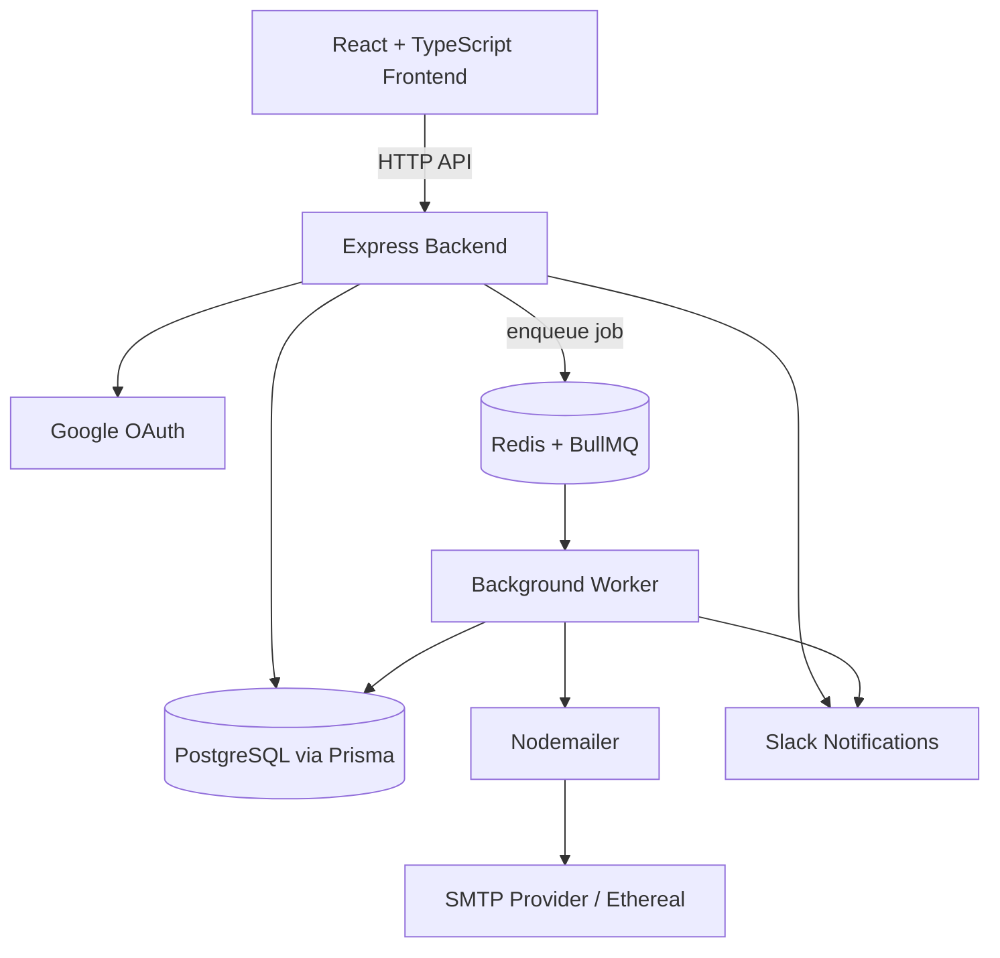

<h1 align="center">📬 ReachInbox Scheduler</h1>

<p align="center">
  <b>Compose an email, pick a future date and time, and let a background worker deliver it.</b><br/>
  A full-stack email scheduling app with Google sign-in, Redis-backed job queues, and a live dashboard.
</p>

<p align="center">
  
  
  
  
  
  
  
  
  
  
  
  
</p>

<p align="center">
  <a href="YOUR_LIVE_DEMO_LINK">🌐 Live Demo</a> ·
  <a href="YOUR_VIDEO_LINK">🎥 Demo Video</a> ·
  <a href="#-architecture">🏗️ Architecture</a> ·
  <a href="#-getting-started">🚀 Getting Started</a>
</p>

<!-- TODO: record a 10-15s GIF: sign in -> compose -> schedule -> email moves to Sent -->


## 💡 The Problem

Sending an email "later" sounds simple, but it needs a reliable system behind it: jobs
must survive page reloads, run at the right time without blocking the web server, and
report their status back to the user. ReachInbox Scheduler solves this with a **queue +
worker architecture**, so scheduling and delivery are separated from the API request cycle.

## ⚡ What It Does

- ✉️ **Schedule emails** for a future date and time
- 📊 **Dashboard** to track scheduled and sent emails, with tabs, search, and pagination
- 🔑 **Google OAuth** sign-in with session-based authentication
- ⚙️ **Background processing** of scheduled jobs using BullMQ and Redis
- 🧪 **Safe delivery testing** with Ethereal Email (no messages reach real recipients)
- 🔔 **Slack notifications** for supported email events
- 🖥️ **Job monitoring** through Bull Board
- 🔐 **Encrypted integration tokens** stored in the database
- 📱 **Responsive UI** with a modern light-themed layout

---

## 🏗️ Architecture



### Scheduling lifecycle

```text
1. User composes an email and picks a future date/time
2. API validates the request and stores the email in PostgreSQL
3. A job is added to the BullMQ queue (Redis)
4. The background worker picks up the job when it is due
5. Nodemailer sends the message through the configured SMTP provider
6. Email status is updated to "sent" and shown in the dashboard
7. Slack notification is sent when configured
```

---

## 🧩 Engineering Highlights

| Area | What I built | Why it matters |
|---|---|---|
| **Queue + worker design** | BullMQ jobs on Redis, processed by a separate worker process | Delivery doesn't block the API and can be monitored and restarted independently |
| **Authentication** | Google OAuth with session-based auth | No passwords to store; familiar sign-in flow |
| **Data layer** | PostgreSQL with Prisma ORM | Type-safe queries and migration-based schema management |
| **Token security** | Integration tokens encrypted before storage | Sensitive credentials are not kept in plain text |
| **Observability** | Bull Board for job monitoring | Easy to inspect queued, active, and failed jobs |
| **Safe testing** | Ethereal Email for SMTP in development | Test full delivery flow without emailing real people |
| **Integrations** | Slack notifications for email events | Real-time visibility outside the app |
| **Dev experience** | Docker Compose for supporting services | One command to start PostgreSQL and Redis |

---

## 🛠️ Tech Stack

| Layer | Technologies |
|---|---|
| **Frontend** | React, TypeScript, Vite, Tailwind CSS, Lucide React |
| **Backend** | Node.js, Express.js, TypeScript, Prisma ORM, Nodemailer, Google OAuth, session-based auth |
| **Queue & Cache** | Redis, BullMQ, Bull Board |
| **Database** | PostgreSQL |
| **Search** | Elasticsearch (optional, if enabled) |
| **Integrations** | Slack API, Ethereal Email (SMTP testing) |
| **Infrastructure** | Docker Desktop, Docker Compose |

---

## 🔌 API Reference

| Method | Endpoint | Purpose |
|---|---|---|
| GET | `/api/auth/me` | Get the currently authenticated user |
| GET | `/api/auth/google` | Start Google OAuth sign-in |
| POST | `/api/auth/logout` | Log out the current user |
| GET | `/api/emails` | List email records |
| POST | `/api/emails/schedule` | Schedule an email |

See the backend route definitions for request schemas, validation rules, and any
additional endpoints.

---

## 📂 Project Structure

```text
Reachinbox-Scheduler/
├── backend/
│   ├── src/
│   ├── prisma/
│   └── package.json
├── frontend/
│   ├── src/
│   └── package.json
├── docker-compose.yml
├── .gitignore
└── README.md
```

> The exact files and folders may vary as the project evolves.

---

## 🚀 Getting Started

**Prerequisites**

- [Node.js and npm](https://nodejs.org/)
- [Docker Desktop](https://www.docker.com/products/docker-desktop/)
- [Git](https://git-scm.com/)
- Google Cloud project with OAuth credentials
- SMTP credentials or an [Ethereal Email](https://ethereal.email/) account
- Slack app credentials (only if Slack notifications are enabled)

### 1. Clone

```bash
git clone https://github.com/Gautam0804/Reachinbox-Scheduler.git
cd Reachinbox-Scheduler
```

### 2. Configure environment variables

Create the environment files expected by the backend and frontend. Depending on the
features you enable, you will need:

- Database connection URL
- Redis connection URL
- Google OAuth client ID and secret
- Session secret
- SMTP host, port, username, and password
- Slack OAuth credentials
- Encryption key for stored integration tokens
- Frontend origin and backend port
- Elasticsearch configuration (if enabled)

> Use the exact variable names expected by the backend config. Never commit `.env`
> files, API keys, OAuth secrets, session secrets, or access tokens.

### 3. Start PostgreSQL and Redis

```bash
docker compose up -d
docker compose ps
```

### 4. Start the backend

```bash
cd backend
npm install
npx prisma migrate deploy   # or follow your project's Prisma workflow
npm run dev
```

### 5. Start the background worker (separate terminal)

```bash
cd backend
npm run worker
```

Keep the worker running, since it processes scheduled email jobs.

### 6. Start the frontend (separate terminal)

```bash
cd frontend
npm install
npm run dev
```

Open the URL printed by Vite, usually **http://localhost:5173**.
The dev server proxies API requests to the backend.

> These steps assume the matching npm scripts are configured in each package.

---

## 🧪 How to Use

1. Start Docker services, the backend, and the worker
2. Open the app and sign in with Google
3. Click **Compose Email**
4. Enter recipient, subject, and message
5. Choose a future date and time, then schedule
6. Check the **Scheduled** tab to confirm it appears
7. Keep the worker running until the job is processed
8. Check the **Sent** tab and history for the final status

For development, Ethereal Email provides a preview link for test messages. It does not
deliver to real recipients.

---

## ✅ Testing

```bash
# Backend type-check
cd backend && npx tsc --noEmit

# Frontend type-check (if the script exists)
cd frontend && npm run typecheck

# Automated tests (if configured)
npm test
```

**Manual verification checklist**

- Google sign-in and sign-out
- Scheduling validation (past dates rejected, required fields)
- Scheduled email appears in the dashboard
- Scheduled → Sent status update after the worker runs
- Search, tabs, and pagination
- Slack notification (when configured)
- Responsive layout and Compose Email modal

---

## 🔒 Security Notes

- Never commit secrets, `.env` files, or credentials
- Use a strong session secret and encryption key
- Configure OAuth redirect URLs for your own environment
- Restrict access to the Bull Board monitoring interface
- Disable development-only rate-limit bypasses and test settings in production
- Use production-grade SMTP credentials before real-world use
- Enforce authentication and authorization on protected API routes
- Use HTTPS and secure cookie settings in production

---

## 🧯 Troubleshooting

| Problem | What to check |
|---|---|
| Backend can't connect to PostgreSQL | Container is running, connection URL is correct, database is reachable |
| Scheduled emails aren't sent | Redis is running, backend **and** worker are running, delivery time has arrived, SMTP/Ethereal config is correct, worker logs |
| Google sign-in fails | Client ID/secret, authorized redirect URI in Google Cloud Console, callback URL and session config |
| Slack notifications fail | Integration credentials, bot added to the channel, backend/worker logs |

---

## ⚠️ Known Limitations

<!-- TODO: edit to match reality -->
- Not yet deployed; runs locally only
- Limited automated test coverage
- Delivery logs, retry visibility, and error reporting can be improved


## 📄 License

No license has been specified yet. Add a `LICENSE` file (for example MIT) before
distributing the project as open source.

---

## 👨‍💻 Author

**Gautam Kumar Yadav** · Full-Stack & AI Engineer

[](https://github.com/Gautam0804)
[](https://www.linkedin.com/in/gautam-yadav-10922726b)
[](https://gautam-portfolio-self.vercel.app/)
[](mailto:gautamcodesin@gmail.com)

---

<p align="center">⭐ If you find this project useful, consider giving it a star!</p>
